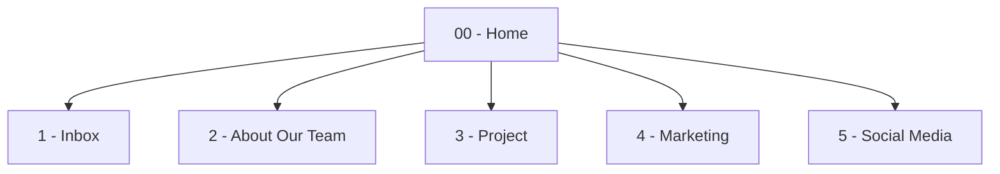

# GymBro Brain

A portable knowledge vault for **GymBro** (gymbros.com) — a Persian-first fitness marketplace that connects users, trainers, and gyms. It is written in English so any AI assistant can load it and continue the work without re-asking questions.

> [!info] Vault owner
> Armin — founder, CEO, and backend developer. Start with [[About Me - Armin]].

## 60-second summary
- **What:** an "Uber for fitness". Trainers replace drivers, users replace riders, gyms are a second supply side → [[Product Vision]]
- **Differentiators:** in-gym active workout logging, digital workout plans, Google Gemini Vision AI calorie scanning, home-workout fallback, Cabbage mascot gamification, 1RM Brzycki calculator → [[Feature Map]]
- **Market:** Tehran first, Persian-first UI, prices in Toman → [[Go-To-Market Strategy]]
- **Money:** Pro subscription + coins + commissions (10% trainers, 5% gyms) → [[Monetization Model]]
- **Stack:** Flutter (Material Design 3 Android client, Release APK v1.0.0) · NestJS (REST) · React admin · PostgreSQL + MongoDB via Prisma · DragonflyDB · JWT · Google Gemini 1.5 Flash Vision / OpenRouter / DeepSeek → [[Tech Stack]]
- **Status:** Flutter Android client complete, APK generated (`GymBro-v1.0.0.apk`), database seeded with Armin Chinipardaz's verified workout split & diet, backend schema complete → [[Current Build Status]]

## Read this first (AI assistants)
1. [[AI Collaboration Guide]] — language, tone, what to avoid
2. [[About Me - Armin]] — who you are talking to
3. [[Known Inconsistencies]] and [[Open Questions]] — never present contested numbers as facts
4. [[Architecture Decisions]] — what is locked, what was rejected, and why

## The five areas
| # | Area | Hub | What lives here |
|---|------|-----|-----------------|
| 1 | Inbox | [[Inbox Hub]] | Open questions, contradictions, parked ideas |
| 2 | About Our Team | [[Team Hub]] | Armin, the ML lead, the future sales team, how to work with us |
| 3 | Project | [[Project Hub]] | Product, business model, tech, data, AI, roadmap |
| 4 | Marketing | [[Marketing Hub]] | Go-to-market, positioning, validation, growth mechanics |
| 5 | Social Media | [[Social Media Hub]] | Personal-brand strategy, content, video setup |

## Status legend (frontmatter `status`)
| status | meaning |
|--------|---------|
| decided | Armin decided or explicitly confirmed it |
| working-assumption | proposed in discussion and used as the baseline, but not validated |
| idea | discussed, not committed |
| open | unresolved |
| reference | descriptive or navigation note |

## Vault map

## Conventions
- One idea per note, connected with double-bracket wikilinks; every note ends with a Related line
- New information goes into the relevant note; bump `updated`; keep `status` honest
- Currency is always **Toman** (1 Toman = 10 Rial) — see [[Glossary]]
- Keep sensitive personal data out of this vault
