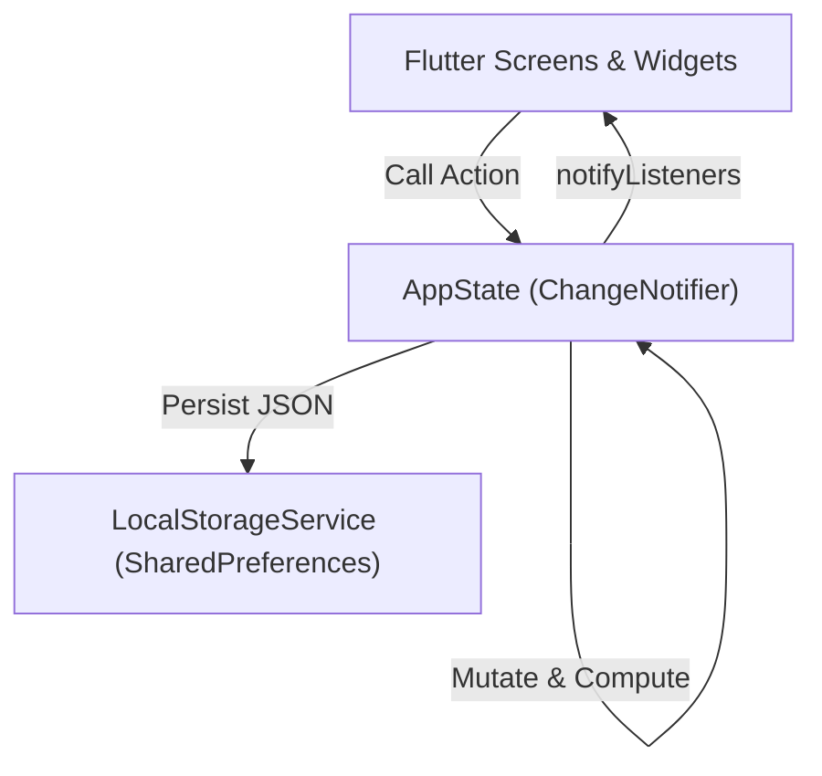

# 03 — DATA MODELS & STATE MANAGEMENT

این سند ساختار داده‌ای، معماری وضعیت و تعاملات ذخیره‌سازی محلی GymBro را تشریح می‌کند.

---

## ۱. معماری تک‌منبعی وضعیت (`AppState`)
پیاده‌سازی‌شده در `lib/state/app_state.dart` به عنوان قلب تپنده برنامه:
- مبتنی بر الگوی استاندارد و تست‌پذیر `ChangeNotifier`.
- دسترسی از طریق `Provider` یا پاس مستقیم در ویجت‌تری.
- ذخیره و بازیابی تمام عملیات از طریق اینترفیس `LocalStorageService`.

---

## ۲. مخزن مدل‌های داده (Core Models)

### الف. کاربر و سطح ورزشی (`UserProfile` & `LevelProgressInfo`)
- **فایل:** `lib/models/user_profile.dart` و `lib/models/user_level.dart`
- **ویژگی‌ها:** `id`, `fullName`, `email`, `heightCm`, `currentWeightKg`, `targetWeightKg`, `level`, `streakDays`, `coins`.
- **سیستم ارتقای سطح (4-Tier Progression):**
  1. **Bronze (مبتدی):** شروع مسیر ورزشی.
  2. **Silver (ورزشکار مستمر):** بیش از ۱۰ جلسه تمرین یا ۷ روز استمرار.
  3. **Gold (حرفه‌ای):** بیش از ۳۰ جلسه تمرین و استمرار مداوم.
  4. **Elite (قهرمان باشگاه):** پایبندی کامل به رکوردها و تغذیه.

### ب. تمرینات ورزشی (`WorkoutPlan` & `Exercise`)
- **فایل‌ها:** `lib/models/workout_plan.dart` و `lib/models/exercise.dart`
- **ویژگی‌های برنامه (`WorkoutPlan`):**
  - `id`, `titleFa`, `splitType` (مثل سینه و زیربغل، بالاتنه/پایین‌تنه)، `daysPerWeek`, `difficulty`, `isHomeWorkout`.
  - `exercises`: لیستی از `WorkoutPlanExercise` شامل `exerciseId`, `targetSets`, `targetReps`, `targetWeightKg`, `restSeconds`.
- **بانک حرکات (`Exercise`):**
  - نام فارسی و انگلیسی، عضله هدف (`Chest`, `Back`, `Legs`, `Shoulders`, `Arms`, `Core`)، تجهیزات (`Barbell`, `Dumbbell`, `Machine`, `Cable`, `Bodyweight`)، و آموزش فرم حرکت.

### ج. جلسه تمرینی زنده و پیش‌نویس فعال (`ActiveWorkoutDraft` & `WorkoutLog`)
- **فایل‌ها:** `lib/models/workout_log.dart`
- **ویژگی‌ها:** ثبت زنده هر ست، چک‌مارک انجام، محاسبه آنی تناژ تناسبی ($Volume = \sum Weight \times Reps$).
- پایداری در صورت بسته شدن ناگهانی برنامه از طریق ذخیره خودکار Draft.

### د. پایش تغذیه و هیدراتاسیون (`NutritionPlan`, `CalorieScanLog`, `WaterLog`)
- **فایل‌ها:** `lib/models/calorie_scan_log.dart`
- **`NutritionPlan`:** تارگت روزانه کالری، پروتئین، کربوهیدرات، چربی و میزان آب (`targetWaterMl`).
- **`CalorieScanLog`:** ثبت غذا با نام، نوع وعده (صبحانه، ناهار، شام، میان‌وعده)، کالری، گرم درشت‌مغذی‌ها و تاریخ.
- **`WaterLog`:** ردیابی میلی‌لیتری آب با تاریخ و ساعت (`state.logWater(250)` و `state.undoWater(250)`).
- **Single Source of Truth:** وضعیت آب و کالری همزمان در صفحه تغذیه و صفحه اصلی (داشبورد) همگام است.

### ه. ارزیابی بدنی و سایزگیری (`WeightRecord` & `BodyMeasurementRecord`)
- **فایل‌ها:** `lib/models/body_analytics_models.dart`
- سوابق وزن، نمودارهای پیشرفت، دور سینه، دور کمر، بازو، ران و درصد چربی.

---

## ۳. لایه ذخیره‌سازی محلی (`LocalStorageService`)
- پیاده‌سازی‌شده در `lib/core/storage/local_storage_service.dart`.
- تمام داده‌ها در کلیدهای مجزای `SharedPreferences` با سریال‌سازی JSON امن ذخیره می‌شوند.
- مجهز به متد `init()` برای بازخوانی در زمان راه‌اندازی اپلیکیشن و تست‌ها.
- کلاس `DatabaseSeeder` به صورت خودکار داده‌های واقعی اولیه (برنامه‌های تمرینی پیش‌فرض، غذاهای ورزشی پرتکرار، سوابق وزن گذشته) را در اولین اجرا بارگذاری می‌کند تا برنامه هرگز با صفحه خالی مواجه نشود.
